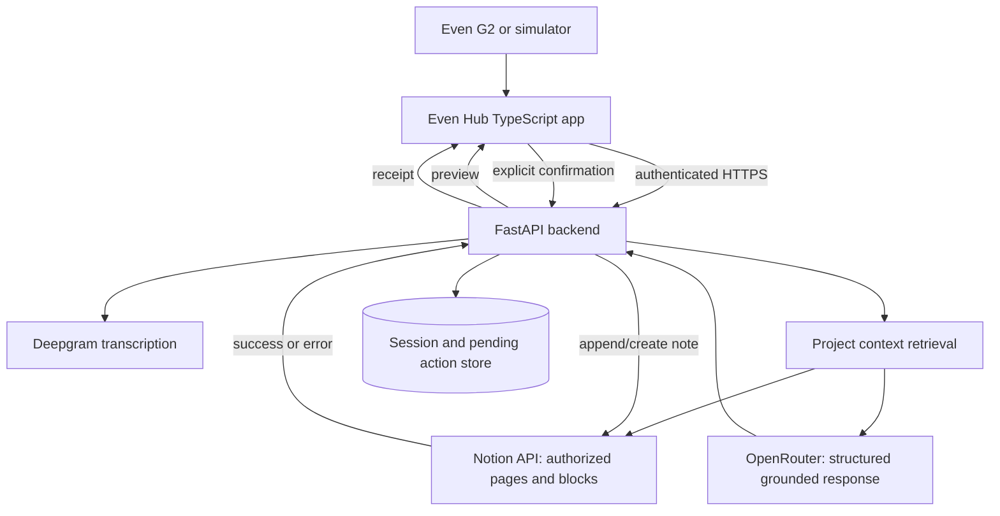

# Scribe — Product and technical brief
Version 1.0 | Heads Up hackathon MVP | November 2026

## 1. Product
Scribe is a context-aware wearable writing companion for Even G2. It helps writers capture fleeting ideas, recall existing creative work, discover connections and develop thoughts away from their desks. Notion remains the durable writing workspace; the glasses provide short visual responses, deliberate voice capture and gesture-based confirmation.

**Tagline:** Capture inspiration. Keep your creative flow.

## 2. Problem and users
Ideas often arrive while walking, cooking or away from a writing desk. Opening a phone interrupts attention, and disconnected voice notes lose project context. Writers need a way to preserve ideas and reconnect them to existing work without opening a full editor.

Primary MVP user: a novelist with an existing structured writing project. Secondary users: screenwriters, journalists, researchers, poets and content writers. The initial demo uses fiction because character relationships and plot continuity make contextual retrieval easy to demonstrate. This is a scope choice, not a restriction on the long-term product.

## 3. Solution and differentiation
Scribe combines deliberate dictation, project-scoped retrieval and confirmed Notion writes. Its flagship feature is connecting a newly captured thought to existing notes, characters or chapters, with traceable source references. It may flag a possible contradiction, but never claims to know the entire manuscript or silently rewrites it. Preserve the writer's original transcription separately from AI summaries and suggestions.

## 4. Hackathon fit
Primary track: AI Assistants & Work. Qualifying integrations: Notion and OpenRouter. Even Hub provides the display and input layer. Read: retrieve real project material. Write: append a confirmed note or task to the actual Notion workspace. Demonstrate both in the simulator. Telegram is excluded from this MVP. The supplied event announcement gives Nov 23–29, 2026 as build week and Dec 3 as Demo Day. Verify exact submission cutoff, scoring, packaging, repository visibility and video requirements against the current organizer listing before submission; earlier conversation reported a three-minute video limit, which is a sensible working target but is not independently reverified here.

## 5. MVP scope and acceptance
| Priority | Feature | Acceptance |
|---|---|---|
| P0 | Project selection | List at least two authorized Notion projects; select one and retain selection during session |
| P0 | Deliberate voice capture | Start/stop via supported gesture; show recording state; cancel; transcribe actual audio |
| P0 | Review and save | Show short transcript pages, proposed destination and explicit confirmation; append original transcript and metadata to Notion exactly once |
| P0 | Context retrieval | Read actual project notes and return relevant excerpts with page/block references |
| P0 | Idea connections | Show one grounded connection or possible contradiction; show no-match when evidence is insufficient |
| P1 | Recall | Ask a question by voice; answer briefly with source label; allow saving a follow-up note |
| P1 | Brainstorm | Generate one project-aware suggestion at a time; save selected suggestion separately after confirmation |
| P2 | Tasks and recap | Create a simple task or view recent captures if time remains |

P0 is the minimum competitive demo. P1 uses the same capture, retrieval and save pipeline. P2 must not delay submission.

### Non-goals
No camera, OCR, photography, visual recognition, speaker playback, always-on listening, background notifications, full manuscript editor, autonomous manuscript edits, external web research, arbitrary Notion workspace support or Telegram integration. Do not use the app while driving. Initial onboarding may require a phone or computer; the creative workflow itself should be hands-free apart from deliberate gestures.

## 6. User experience
1. Onboard on a companion web page: connect a Notion integration to a dedicated workspace, authenticate/pair the G2 app, choose a project.
2. Home: Capture, Recall, Brainstorm, Projects. Show active project.
3. Capture: tap to begin, visible recording state, speak, tap to stop. Limit recording to 30 seconds initially; cancel available.
4. Processing: upload audio, transcribe, retrieve context, generate a structured proposal. Show progress and errors.
5. Review: display paginated original transcript; allow retry or discard. Show one short grounded connection with source label. If no source supports a connection, say so.
6. Confirm: show destination and proposed write. Only explicit confirmation creates the note. Cancel never writes.
7. Receipt: show saved status only after Notion acknowledges success. Provide page title and optional link on companion UI.
8. Recall/brainstorm: use the same recording pipeline with different intent. Show short answer/suggestion; optionally save as a new note, never replace source material.

### Demo story
Seed a fictional project, The Forgotten King, with Chapter 4 mentioning an advisor hiding a rebel letter. Dictate: “What if the advisor secretly supports the rebellion?” Scribe retrieves the real Chapter 4 block, displays a possible connection, asks to save, then creates a note in Notion. Open Notion to show the actual saved transcript, AI connection and source reference. Demonstrate a cancelled write and a recall question if time permits. Seeded fiction is demo data; do not pretend it is a real customer manuscript.

## 7. Architecture


### Component responsibilities
- Even Hub app: bridge initialization, SDK display containers, audio events, gesture normalization, recording buffer, state machine, pagination, error/retry UI. No provider secrets in client bundle.
- FastAPI: authentication, project authorization, input limits, transcription adapter, retrieval, LLM validation, pending actions, Notion writes, audit receipts and health endpoint.
- Deepgram: batch transcription of captured audio. Confirm actual SDK format; prior discussion identified 16 kHz signed 16-bit mono PCM. If confirmed, wrap in WAV or use correctly declared raw encoding. Do not assume simulator emits identical audio without testing.
- Notion: source of truth for projects and saved notes. Fetch only explicitly shared project pages. Paginate and recursively read supported blocks with bounded depth and size.
- OpenRouter: classify intent/category, produce short summaries and grounded connections using retrieved snippets. Use a model supporting structured output or validate JSON and retry once. No autonomous tools or writes.
- Storage: SQLite with persistent volume for single-instance demo, or Supabase/Postgres if already available. Store sessions, pending actions, idempotency receipts and optional short-lived cache. Notion remains durable content store. Never rely on ephemeral disk for write deduplication.
- Hosting: Railway backend over HTTPS; host frontend as a static web app (e.g. Vercel) and package per current Even Hub instructions. Simulator and deployed URL must both be tested. Public Even Hub distribution requires separate review.

## 8. Notion workspace and retrieval
Use a predefined workspace with a Projects database and an Ideas database. Projects: title, status, project page. Each project page contains Chapters, Characters, Research and Notes subpages. Ideas: title, project relation, category, original transcript, AI summary, AI connection, source references, created time, capture ID. Store long text in page blocks rather than exceeding property limits. Tasks may be a category initially.

For MVP, enumerate authorized projects from configured database/data-source IDs using the pinned Notion API version. Fetch selected project's child pages and blocks, normalize text into chunks (roughly 300–600 words, smaller where useful), retain page ID, block ID, title and URL. Use keyword/BM25 retrieval with top 3–5 excerpts and bounded token budget. Cache per project with short TTL and refresh after writes. Embeddings/vector DB are optional later. Never search across unauthorized projects. Source labels must resolve to retrieved block IDs; reject fabricated citations. If no relevant evidence, return no-match rather than inventing facts. Treat retrieved notes as untrusted data, not instructions.

## 9. API and state contracts
| Endpoint | Purpose |
|---|---|
| GET /health | Service readiness without secrets |
| GET /projects | Authorized projects |
| POST /transcribe | Bounded audio upload, returns transcript |
| POST /assist | project_id, mode, transcript; returns preview and sources |
| POST /actions/{id}/confirm | Confirm exact immutable proposed write |
| POST /actions/{id}/cancel | Cancel pending write |
| GET /actions/{id} | Resolve uncertain save status |

Use authenticated requests and validate project ownership server-side. Response schema: `transcript`, `title`, `category`, `summary`, `connection_type` (related/possible_conflict/none), `connection`, `sources[]`, `destination`, `action_id`, `expires_at`. Pending action binds user, project, immutable payload and expiry. Confirm must be idempotent; use unique capture ID and check Notion for that ID after ambiguous timeout before retrying. Prevent concurrent duplicate confirms with a durable lock/unique constraint. Never report saved until verified. Cancelled/expired actions cannot execute.

Client states: boot → home → recording → transcribing → retrieving → review → confirmation → saving → receipt. Errors return to a safe retry state; keep transcript when possible. No write from recording, retrieval or model response alone.

## 10. Display and audio constraints
Use native SDK-supported text/list containers, not a desktop dashboard mirrored to glasses. Prior discussion reports a 576×288 monochrome display; verify current SDK limits, container counts, text lengths, gesture semantics and actual simulator rendering. One primary action per screen, short lines, high contrast, paginated transcript, clear recording indicator and cancel/back. Avoid tiny text and long paragraphs. Test gesture debouncing and prevent double confirmation. Simulator audio may require a documented alternate microphone path; any browser-mic fallback must be labelled and must not be presented as verified physical G2 capture.

## 11. Security, privacy and reliability
- Use a dedicated Notion integration with minimum read/insert permissions and a demo-only workspace. For a public multi-user product, implement proper Notion OAuth and per-user isolation; a single-workspace paired demo is acceptable if disclosed.
- Keep keys server-side in environment variables; commit only .env.example. Pair with expiring random codes or authenticated companion session; do not expose unauthenticated write endpoints.
- Record only after deliberate user action; stop on cancel/timeout. Delete raw audio after transcription unless explicitly retained. Disclose external transcription and AI processing; use synthetic demo content. No covert interview recording.
- Limit audio duration/size, rate-limit requests, restrict CORS, use HTTPS, validate schemas and sanitize logs. Do not log manuscripts, transcripts, keys or audio.
- Handle provider timeouts, 429s, unavailable workspace, no-match, invalid model output, lost network and failed saves. Preserve unsaved transcript for retry within session. Never fabricate success.

## 12. Resources and setup
Official starting points from earlier discussion; verify current URLs, package versions and SDK behavior during Phase 0 (not freshly checked for this document).
- Even Hub portal/docs: https://hub.evenrealities.com/ and https://hub.evenrealities.com/docs/get-started/overview
- Starter templates (prefer ASR): https://github.com/even-realities/evenhub-templates
- AI coding skills: https://github.com/even-realities/everything-evenhub
- SDK: https://www.npmjs.com/package/@evenrealities/even_hub_sdk
- Simulator: https://www.npmjs.com/package/@evenrealities/evenhub-simulator
- CLI: https://www.npmjs.com/package/@evenrealities/evenhub-cli
- Notion: https://developers.notion.com/
- Deepgram: https://developers.deepgram.com/
- OpenRouter: https://openrouter.ai/docs
- FastAPI: https://fastapi.tiangolo.com/
- Vite: https://vite.dev/guide/
- Railway: https://docs.railway.com/
- Supabase (optional): https://supabase.com/docs
- Event listing to verify: https://dorahacks.io/hackathon/even-realities/detail

Required: Windows development machine, supported Node/npm and Python versions, Git, Even Hub developer access, Notion workspace/integration, Deepgram and OpenRouter keys/credits, hosting account. Actual access, quotas and costs are not confirmed. Pin versions after starter validation.

## 13. Repository and configuration
```
scribe/
  apps/g2/           # Vite, TypeScript, SDK bridge and state machine
  apps/companion/    # minimal setup/pairing UI (may share frontend)
  services/api/      # FastAPI routes, adapters, retrieval, actions
  tests/             # fixtures, integration and end-to-end checks
  docs/              # architecture, demo, privacy, setup
  brief.md
  todo.md
  README.md
  .env.example
  .gitignore
```
Server variables: NOTION_TOKEN, NOTION_PROJECTS_ID, NOTION_IDEAS_ID, NOTION_API_VERSION, DEEPGRAM_API_KEY, OPENROUTER_API_KEY, OPENROUTER_MODEL, DATABASE_URL, SESSION_SECRET, ALLOWED_ORIGINS. Client: VITE_API_BASE_URL only (no secrets). Document exact names and IDs after implementation.

## 14. Definition of done
- Real simulator display and gesture navigation; actual voice capture path demonstrated and labelled.
- Real transcription, Notion retrieval, grounded AI response and confirmed Notion write in one end-to-end flow.
- Cancellation, duplicate confirmation, no-match and provider failure tested.
- At least one recall or brainstorming flow if P0 is stable.
- Deployed HTTPS backend and reproducible setup; public demo contains no credentials or private content.
- README, architecture, known limitations, demo video, submission form and package if required.

## 15. Risks and decisions
First gate: prove SDK audio and gestures on Windows before building the rest. Second gate: prove Notion read/write and API credits. If simulator audio is unavailable, use an explicitly disclosed browser-mic fallback for development and verify whether organizers accept it. Physical G2 behavior remains unverified without hardware. Do not claim app-store availability merely because the backend is deployed. Notion template, single-workspace pilot, lexical retrieval and batch transcription are deliberate time-saving defaults. No integration has been executed as part of writing this brief.
